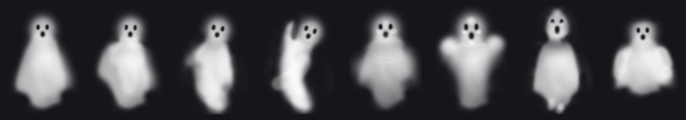

# The Wall Starts to Move

**Qian Li** · Site-specific projection proposal · 2026 · [Live study](https://ludwigpeking.github.io/projection-on-brick-wall/)

## Artist Statement

I make installations that use light, code, and sensors to bring the city's solid surfaces to life. I keep coming back to walls, bodies, and screens: what stays fixed, what gets to move, and who is watching.

Cities feel permanent, but they are really very slow performances. My work speeds one up for a moment.

I work with real-time graphics, projection mapping, computer vision, simulation, and generated sound. I build a digital twin of each site and test the piece there before it reaches the real one.

I want people to doubt a surface they pass every day, and then walk a little closer.

## Proposal

| | |
| --- | --- |
| **Type** | Site-specific, audience-responsive projection mapping |
| **Site** | Brick wall off Pearl St / Jay St, Downtown Brooklyn, about 8 × 12 m |
| **Run** | 97-second loop, dusk to 11 pm, 3+ nights, free |

**Concept.** At night, ghosts seem to push out of a flat brick wall. The depth is an illusion of light, drawn for the viewer's position.

| The wall today | Site plan |
| --- | --- |
|  |  |

**Experience.** Three scenes play in a shuffled loop, set to an original rock soundtrack:

1. **Faces** pop out on the beat.
2. **A flock** swims across the wall.
3. **Rows of ghosts** dance.

**Sketches.** These are my eight ghost drawings. Each one becomes a height map that pushes bricks out of the wall.

| Flock | Dance |
| --- | --- |
|  |  |

**What's new.** The current study is a fixed loop. This version makes the ghosts react to the audience: a depth camera tracks people on the sidewalk, and the flock steers toward or away from them.

**How it works.** The piece is rendered in real time in the browser with WebGL. Each brick is modeled in 3D and re-projected onto the flat wall for the viewer's eye position. It is mapped to the wall by four-corner registration and output as a 4K feed.

**Feasibility.** The digital study, the 4K exports, and the web app are done. Still needed: an on-site test at dusk with a 20,000+ lumen laser projector.

**Equipment.** A 20–30k lumen laser projector, a computer, a depth camera, 2 speakers, and power and permits.

**Timeline.** Weeks 1–2: survey and permits. Weeks 3–4: interaction. Week 5: on-site test. Week 6: tuning. Week 7: public nights.
