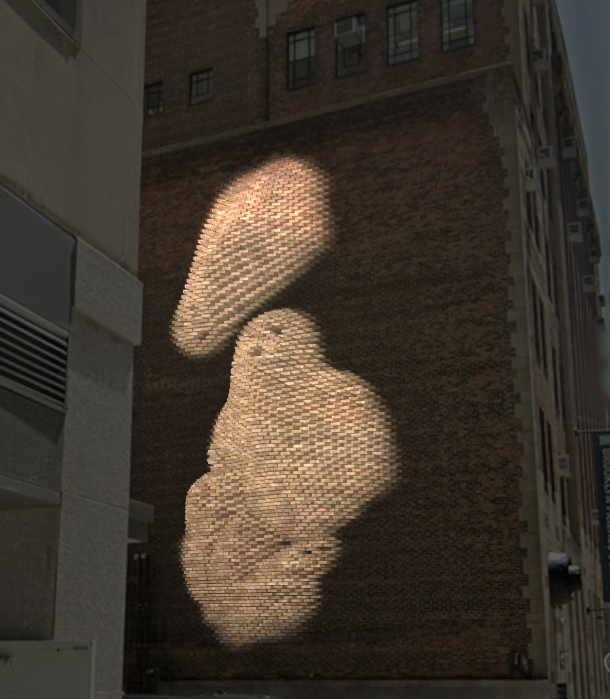
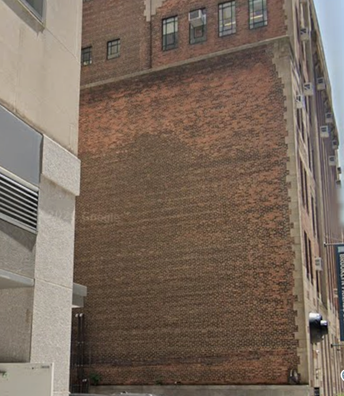
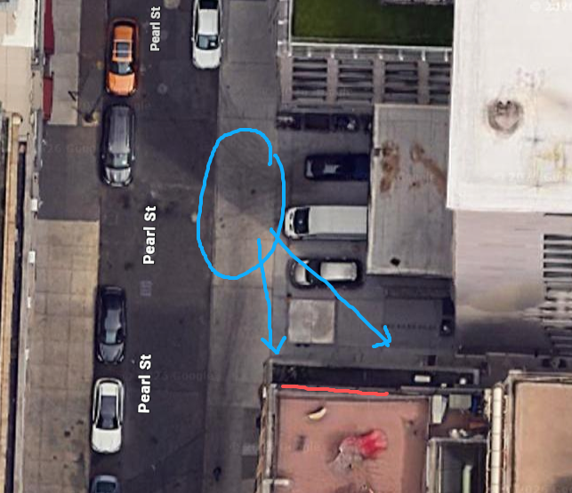
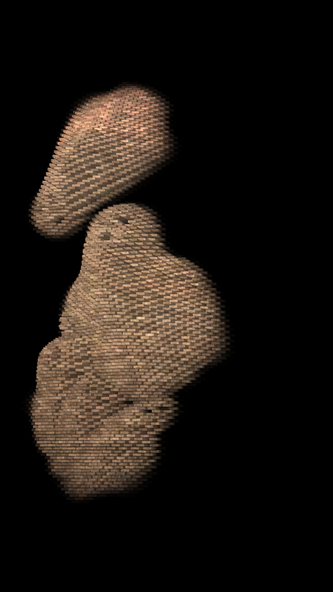
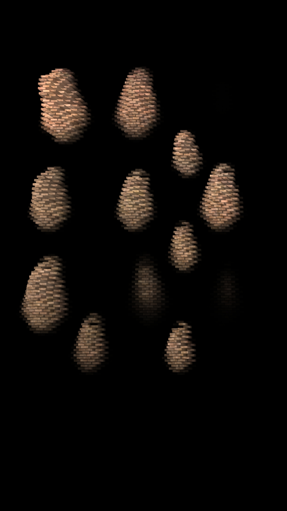
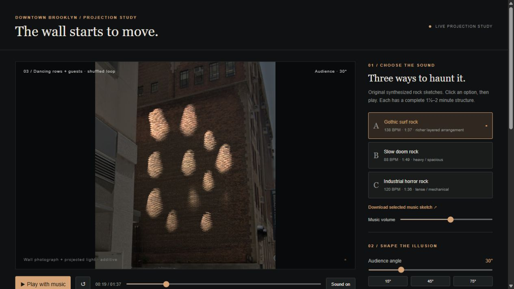

# The Wall Starts to Move

**Qian Li** · Site-specific projection proposal · 2026

🔗 [Live projection study](https://ludwigpeking.github.io/projection-on-brick-wall/)

---

## Part 1 · Artist Statement

I make installations that use light, code, and sensors to bring the city's solid surfaces to life. I keep coming back to walls, bodies, and screens: what stays fixed, what gets to move, and who is watching.

Cities feel permanent, but they are really very slow performances. My work speeds one up for a moment.

I work with real-time graphics, projection mapping, computer vision, simulation, and generated sound. I build a digital twin of each site and test the piece there before it reaches the real one.

I want people to doubt a surface they pass every day, and then walk a little closer.

---

## Part 2 · Project Proposal

### Overview

| | |
| --- | --- |
| **Title** | The Wall Starts to Move |
| **Type** | Site-specific projection mapping, audience-responsive |
| **Site** | Blank brick wall off Pearl St / Jay St, Downtown Brooklyn |
| **Surface** | about 8 m wide × 12 m high, running-bond brick |
| **Duration** | 97-second looping piece; dusk to 11 pm, 3 nights or more |
| **Audience** | Passersby on the sidewalk; free; no app needed |

### Concept

One blank wall comes alive at night. Bricks seem to push out of the wall and form ghosts: faces pop out on the beat, a flock drifts across, and then rows of ghosts dance. The wall stays physically flat. The depth is an illusion of light, drawn for where the viewer stands.

### The Site

- It is a windowless brick wall, visible from the Pearl St sidewalk.
- Audience view: 15°–75° off-axis from the sidewalk.
- Projector: mounted across the street, aimed at the wall.

### The Experience

1. **Faces.** Faces pop out of the bricks in time with the music.
2. **Flock.** Ghosts swim across the whole wall as a flock (boids).
3. **Dance.** 18–23 ghosts dance in rows, rising and sinking with the beat.

These three scenes play in a shuffled loop with an original rock soundtrack (gothic surf, 138 BPM).

### What's New (Improvement on Existing Work)

The existing study is a fixed video loop. **This proposal makes the ghosts react to the audience.**

- An overhead depth camera tracks people on the sidewalk.
- The flock steers toward or away from passersby.
- Perspective adjusts to where the crowd stands, so the 3D illusion holds for more people.

The original ghost sketch (ITP Physical Computing midterm) already used Kinect input, and the projection study already runs in real time in a browser. This step connects the two.

### How It Works

- **Rendering:** WebGL in the browser; every brick is modelled with real displacement.
- **Illusion:** Each virtual 3D point is re-projected onto the flat wall for the viewer's eye position.
- **Mapping:** A four-corner homography registers the image to the wall photo, then on-site alignment fine-tunes it.
- **Sound:** Three original synthesized soundtracks; visuals lock to the audio clock.
- **Output:** 4K portrait and landscape feeds, plus a black background, so only the ghosts receive light.

### Feasibility

- **Done:** Full digital study, 4K exports, wall registration, live web app.
- **Needed:** An on-site test with a 20,000+ lumen laser projector at dusk; a better wall photo survey.
- **Risk:** Ambient street light reduces contrast. Plan: start after dusk and use a high-brightness projector.

### Equipment

- 1 × 20,000–30,000 lm laser projector (e.g. Epson PL30000 class), portrait-capable
- 1 × computer running the browser renderer
- 1 × depth camera (Kinect / Orbbec) + mount
- 2 × outdoor speakers
- Weatherproof enclosure, power, permits

### Timeline

| Weeks | Task |
| --- | --- |
| 1–2 | Site survey, wall photo, permits |
| 3–4 | Camera tracking + interactive flock |
| 5 | On-site projector and registration test |
| 6 | Tuning and sound |
| 7 | Public nights |

### Links

- Live study: <https://ludwigpeking.github.io/projection-on-brick-wall/>
- Technical notes: [below](#brick-relief-motion-study-technical-notes)

---

# Brick relief motion study: technical notes

Interactive projection study and 4K export workflow for an approximately **8 m wide × 12 m high** brick wall in downtown Brooklyn.

## Online app

Open [the live projection study](https://ludwigpeking.github.io/projection-on-brick-wall/). The hosted app includes the current animation, all three soundtracks, wall registration, projector modes, and frame/settings downloads. Press Play to start audio.

Push changes to `main` to test and publish automatically through GitHub Pages. `node scripts/build_site.cjs` prepares `_site/` using an explicit list of browser assets. Finished MP4s, archive material, logs, and local render services are not published. Video rendering still uses the local export server; the online app provides the interactive preview and live projector feed.

## Folder guide

| Location | Contents |
| --- | --- |
| `exports/` | Finished portrait and landscape MP4s, plus `loop-player.html` for repeating playback |
| `exports/support/` | Export settings, render status, encoder logs, check results, and captured frames |
| `audio/` | Soundtracks and arrangement metadata |
| `assets/` | Original ghost drawings and wall/site reference images |
| `scripts/` | Music generators, soundtrack alignment, and verification tools |
| `archive/previews/` | Earlier design and diagnosis screenshots |
| `archive/logs/` | Previous server logs and current server output |
| Project root | Live preview, renderer, server code, export configuration, and launcher |

The finished video paths and looping-player URL are unchanged. Two empty legacy logs, `preview-server.log` and `preview-server-error.log`, were left in the root because an existing process still holds them open. No project files were deleted during organization.

Open **http://127.0.0.1:8840/** while the local preview is running. To restart it, double-click `START-PREVIEW.cmd` (requires Node.js), or run `node serve.cjs` from this directory. The server listens only on this computer's loopback interface.

## Try the study

1. Start with **Gothic surf rock**, the requested direction. Press Play with music. Restart begins with a one-beat still wall; faces start within the first second. The initial paused view shows an early pop at about 1.83 seconds.
2. Use the three scene buttons or scrub the timeline. Scenes are exclusive: faces finish before boids appear. The opening uses 16 beats of faces, 24 of flock, and 16 of dancing (about 7, 10, and 7 seconds at 138 BPM). Later sections shuffle in repeatable groups with 12–20 beats each, never repeating the same scene immediately. Each face fully retracts within one beat. Flock and dance sections ease into and out of the wall at their boundaries, without a separate recede chapter. Playback automatically loops the selected soundtrack. Buttons jump to a visible beat in the first occurrence of each scene.
3. Compare **15°, 45°, 75°** audience positions. Angles are from the perpendicular wall normal, not the wall itself. Positive angles put the observer on the positive horizontal side of the model.
4. **On your wall** adds the projected light onto the unchanged dusk photograph using additive blending; it is the default view. **Relief study** shows virtual geometry for shape inspection. **Projector feed** shows the same positive light layer, with lens-dependent cropping and a true black background.
5. Expand **Placement & wall registration** to adjust dimensions, masonry courses, projector and viewer positions, lens, and orientation. The top-down placement graphic comes from these same model positions. Photo corner handles appear when enabled.
6. **Keep view** downloads a JSON record of the music, time, seed, photo corners, and geometry settings, and saves the same record in browser local storage. Keep these JSON files for deciding the final setup. **Save test frame** downloads the current image. In photo mode this includes the reference photo.

## Three original scratch soundtracks

| Option | Tempo | Length | Direction |
| --- | --- | --- | --- |
| Gothic surf rock | 138 BPM | 1:37.39 | Minor tremolo figures, echo, restless backbeat |
| Slow doom rock | 88 BPM | 1:49.09 | Low distorted power chords and half-time drums |
| Industrial horror rock | 120 BPM | 1:36.00 | Muted distorted pulses and mechanical rhythm |

Stereo WAVs are in `audio/`, synthesized locally with NumPy. The richer gothic surf arrangement is generated by `scripts/build_rich_surf.py`: minor ninths, major sevenths and altered dominant chords; two strummed rhythm guitars; tremolo lead and countermelody; organ; moving bass; and varied drums/toms. It starts immediately and ends on a ringing final chord. The earlier version is preserved as `audio/surf-original.wav`. `scripts/build_music.py` generates the initial three sketches; run the richer builder afterward to restore the richer surf version. These contain no sampled recordings and remain synthesized arrangement demos. The audio element's playback clock drives the visual time and beat envelope; seeking and switching tracks preserve the position within the story. Volume starts at 55%.

## Geometry and mapping

The model uses explicit brick front and side faces. A per-brick displacement field sculpts the faces, including nose, brows, eye cavities, and open mouth. Animated masks use all eight supplied ghost drawings in a texture atlas; the flock selects the original neutral, turn, dash, and skid poses. `motion.js` simulates neighbor cohesion, velocity alignment, separation, soft boundary steering, and a reflected-velocity boundary fallback. There are no moving targets, shared drift forces, or independent wandering forces. Headings ease into turns. Each flock entrance rises over roughly two beats with a short stagger, then floats in depth with one quick outward pulse and smooth release per music beat. The default ghost scale control is 1.55, with an additional 1.24 enlargement of the flock and size changes during approaches. This adapts the original sketch's flocking behavior without its Kinect input.

The flock now ports the supplied `ghost.js` algorithm: normalized cohesion, alignment and inverse-distance separation with the original weights 0.01, 0.02 and 0.05; 150-pixel perception/boundary margin; 100-pixel separation distance; 0.8 boundary force; and 0.3–1.2 times maximum speed. Coordinates convert to wall meters and the preview speed control scales simulation time. Original steering thresholds choose neutral, turning, dash and skid drawings. Initial positions and headings are varied and repeatable. The projection adapter adds full-wall center bounds, eased visual heading, and soft emergence. No targets or wandering forces are used.

Each boid varies from 72–108% of its enlarged size over 4–8 seconds. Baseline depth varies independently, and selected ghosts approach farther with brief Gaussian pulses every 5.5–8.5 seconds; the selected subset changes between sections. An approach adds up to 3.2 height units and 15% width, without affecting steering. The movement realm remains the full wall, independent of ghost size; outer contours clip at the edges.

Dancing has an independent population of 18–23 ghosts rather than reusing the flock count. Layouts alternate across visits: 3 × 4, 4 × 3, or 3 × 5 main rows, with extra ghosts in the gaps between both rows and columns. Those extra dancers emerge on staggered offbeats; base rows also vary height, scale, bob, and sway. All use the original unmirrored forward drawing. The renderer supports up to 24 ghosts. The Flock size slider controls the boids only.

**Flock speed** defaults to 3.5× the previous drift and can be adjusted independently from softness. It accelerates travel and steering without shortening the gradual emergence. **Flock softness** controls relief height. A separate broadly feathered mask gradually raises neighboring bricks around the body, while the original mask preserves interior eyes and mouth. Visual headings ease into turns. Flock beat strength controls both the added relief pulse and a synchronized size expansion, independently of flight speed. At the default strength, the peak adds roughly 15–45% width and height; the rhythmic depth contribution is 2.08 times the previous version. Both use the same fast-rise, smooth-release beat envelope and fully settle before the next beat. Centers and headings stay unchanged. Each ghost gets a varied amplitude, with bar/downbeat accents; changing tempo or pulse strength does not change the boid trajectory. Beat faces retain their pop-and-retract envelope.

The floating flock normally has a **0.20 height multiplier** relative to the previous displacement amplitude. A changing subset makes stronger smooth approaches on top of the raised baseline and rhythmic pulse. Other ghosts retain independent depth variation. The approaches use independent Gaussian time envelopes; they do not change the boid trajectories. The body uses a two-dimensional Gaussian profile, multiplied by the Gaussian-filtered silhouette and a zero-slope support taper. There is no constant-height rim: displacement fades back to the wall at the edges. The Gaussian sets relief height. Projected brightness responds smoothly to that height, so shallow edges receive very little light and raised centers stay legible. Alpha remains opaque; no directional spotlight is used. The original low-alpha eyes and mouth remain recessed; their readability still depends on brick sampling. Face height is unchanged.

Simulation runs at fixed 60 Hz and caches the trajectory for the current wall/ghost settings. Playback interpolates from audio time, so seeking or revisiting a moment produces the same flock state. `node scripts/verify_motion.cjs` checks exclusive scenes at all three tempos, shuffled reprises, per-beat faces, stronger boid approaches, independent dancing populations and interstitial emergence, bounds, original neutral poses, beat-independent steering, repeatable seeking, and the zero-depth loop seam.

For virtual surface point `V` and viewer position `C`, the point on the physical wall at `z=0` is:

`P = C + (V - C) * C.z / (C.z - V.z)`

The projector feed views `P` through a separate projector camera. Visibility remains ordered from the virtual viewer. **Fill frame** is the default output composition: uniform magnification and recentering fit the wall to 98% of the limiting frame dimension without stretching. Match this composition using projector zoom/alignment or mapping software on site; it is not the calibrated output of the saved physical lens. **Physical lens preview** retains the original throw-ratio calculation with zero lens shift and roll. The coverage readout checks the four flat-wall corners, not every possible displacement or projector brightness.

The projector canvas renders at the selected native raster, independent of browser size: UHD 4K 3840 × 2160, Full HD 1920 × 1080, or DCI 2K 2048 × 1080, with dimensions swapped in portrait mode. The portrait preview itself has the portrait aspect ratio; no browser-size pillarboxing is baked into saved frames. The pixel readout reports the wall's bounding footprint and quadrilateral raster-area use. `node scripts/verify_projection.cjs` verifies corner coverage, uniform magnification, and 98% limiting-dimension use for all resolutions and orientations. Landscape output fits the tall wall to the available height and keeps black side margins; the wall and its bricks are not stretched.

The flock drawings are used as displacement fields, not transparent ghost overlays. Two localized Gaussian bulges strengthen the body center while retaining the broad faint outer taper. Brick fronts and exposed sides use color sampled from the original wall and stable per-brick material variation. The brightness response is height squared divided by (height squared + 0.10 m squared), multiplied by fixed output gain 1.65. It replaces the former 0.5 mm on/off cutoff: a 1 cm displacement receives about 1% of the response, 5 cm receives 20%, and 10 cm receives 50%, before material and crease shading. Symmetric front-edge shading and darker extrusion roots provide local pseudo-shadow without a directional spotlight. Cavities suppress emitted light separately from height, and overlapping faces keep the cavity value of the winning height surface. Zero displacement emits exactly black in photo/projector modes. No baseline wall pattern is projected; there is no rest-frame subtraction or transparent ghost sprite. These are artistic contact-shading cues, not ray-traced cast shadows. Eyes and mouth stay recessed through the source drawing's low-alpha areas.

The live preview now gives both flock and dancing ghosts a steeper relief profile. It leaves normalized profile values up to 0.08 unchanged, then smoothly increases the height multiplier to 2.2 by profile value 0.45. This keeps the faint low fringe against the wall while exposing larger brick steps toward the body; Gaussian rounding, central bumps, recessed features, and rhythmic motion remain. Beat faces use their separate unchanged profile. All three MP4 exports were regenerated on October 14, 2026 with this profile.

The photo mode uses a four-corner homography and additive `plus-lighter` compositing, not an opaque wall replacement. The output shader emits only nonnegative projected light; unaffected regions emit black and leave the real wall visible. Saved composite frames use Canvas `lighter` with the same dusk background. This is a visual additive preview in display color space, not a calibrated linear-light simulation of projector brightness. Its photograph viewpoint is not surveyed. Defaults assume 36 columns and 160 courses (approximately 222 × 75 mm spacing), with regular running bond. The actual aged wall has irregularities and mixed masonry that this low-resolution image cannot register precisely. Grid/corner adjustments are only a first approximation.

Dancers now travel independently from almost flush with the wall to stronger protrusion over staggered 3.5–6 beat cycles. This scales their beat pulses too, allowing a recessed dancer to stay low while other rows rise. The default photo registration is inset to clear the neighboring pale building, including its protruding ledge. Photo and projector modes clip the final displaced geometry inside the registered wall and feather the innermost boundary. The October 14, 2026 exports include these choreography and boundary changes.

## Before final rendering

Choose the music direction, depth, choreography, and audience position in this preview. Then obtain a sharper, unobstructed wall reference and on-site registration/coverage test. Confirm projector model, lens, position, mounting orientation support, and dusk visibility. The light-only feed is not radiometrically calibrated. Projected black adds no light; it cannot remove ambient illumination from the real bricks. Strong dark cavities in the digital study will lose contrast outdoors.

## 4K exports and repeating playback

`export-settings.json` records the selected setup: 30° audience angle, 0° projector angle, an 8 × 12 m wall, and the current choreography controls. `node export-server.cjs` serves the export station at `http://127.0.0.1:8841/`. Its button renders portrait and landscape in sequence at 30 fps, with 2,922 frames and 97.4 seconds per file. The export server selects NVIDIA encoding on Windows or VideoToolbox on macOS. The latest three exports were encoded on the Mac render host. Synchronous JPEG capture avoids background-tab idle throttling.

The outputs are `exports/brick-ghosts-4k-portrait.mp4` (2160 × 3840) and `exports/brick-ghosts-4k-landscape.mp4` (3840 × 2160), with H.264 video and stereo AAC music. `exports/support/render-status.json` reports the active render; wait for completion before copying its MP4. Settings, encoder logs, captured frames, and verification reports are grouped in exports/support/.

Open `exports/loop-player.html`, select the orientation, press Play, and use the video's fullscreen control. The player enables repeat automatically. In another player, enable its Repeat/Loop option; MP4 files do not impose that setting on other applications.

`exports/brick-ghosts-on-wall-preview.mp4` shows the same animation additively composited onto the complete wall photograph at 1162 × 1334, with the existing music and 97.4-second duration. It is a visual location preview; use the separate black-background feeds for projection. Rebuild it with `python scripts/render_wall_preview.py` (`--proof` exports one sample frame). The script derives the perspective transform from the saved projector configuration and the photo corners saved with that exact projector render, and uses the preview's ambient brightness. It preserves all original frames and copies the soundtrack without re-encoding it.

The preview uses `audio/surf-loop.wav`, generated with `python scripts/build_rich_surf.py --loop`. This variant keeps the closing rhythm, returns harmonically to the opening, and wraps instrument/reverb tails across the boundary without a final fade or silence. The non-looping `surf.wav` remains available. `python scripts/align_export_audio.py` prepares `audio/surf-4k-loop.wav` for exports using circular resampling at 48 kHz: exactly 4,675,200 stereo samples, or 97.4 seconds. The timing adjustment is less than 0.01%. Passing orientation names to that script also replaces the music in completed MP4s while copying their video unchanged. Visual displacement returns to zero at the loop join. `exports/support/audio-loop-check.json` records peak, clipping, and sample-boundary checks; `python scripts/verify_exports.py` validates both finished videos, including complete audio/video decoding.

Reference: [Christie projection mapping primer](https://www.christiedigital.com/globalassets/help-center/whitepapers/documents/Projection-Mapping-Primer.pdf), [Epson projection-distance guidance](https://files.support.epson.com/docid/cpd5/cpd59255/source/setup/reference/pl30000unl/projection_distance_pl30000unl.html).

Source art: the supplied wall and site photos, and `C:\Users\qli\Desktop\ITP\PComp\mid-term\code\images\ghost_0.png` through `ghost_7.png`. Originals were left untouched.
